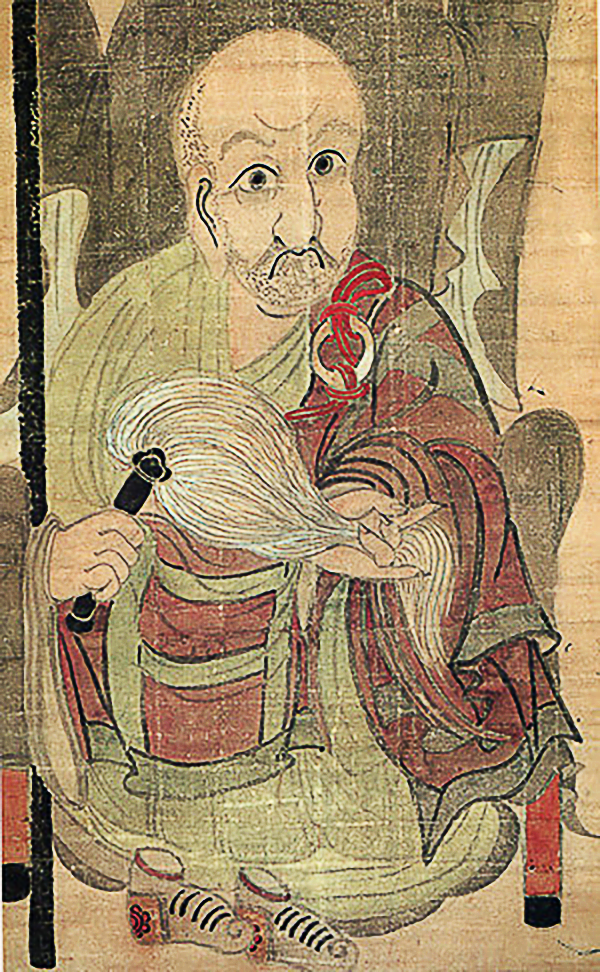

<p align="center">
  
</p>

<h1 align="center">Sensei Mode for Claude Code</h1>

<p align="center">
  <em>"I shall guide. You shall discover."</em>
</p>

<p align="center" style="font-size: 0.85em; color: #666;">
  <sub>
    Portrait: <a href="https://commons.wikimedia.org/wiki/File:Zen-Master-Hakuin-Ekaku-Self-Portrait-1767.png">Zen master Hakuin Ekaku, self-portrait, 1767</a> — public domain.
    In the Zen <em>chinsō</em> tradition, a teacher gives a self-portrait to his disciples as a license.
  </sub>
</p>

<p align="center">
  <a href="#install"></a>
  <a href="LICENSE"></a>
  <a href="https://fredlemieux.github.io/claude-sensei-skill/"></a>
</p>

---

**Sensei Mode** is a Claude Code skill that turns Claude from a *doer* into a *guide*. When active, Claude refuses to hand you working code. Instead it asks the questions that make *you* write the code — adapting its scaffolding to your level, tracking what you've mastered, surfacing what you haven't.

It's built on 10 learning-science foundations and the finding from Anthropic's 2026 RCT that developers who delegate scored **17 percentage points lower** on comprehension tests than those who engaged conceptually.

**The differentiator is cognitive engagement, not AI presence.**

👉 [Read the full research deck](https://fredlemieux.github.io/claude-sensei-skill/)

## What it does

- **Toggle on/off per terminal.** `/sensei on` makes Claude a Socratic mentor. `/sensei off` and you have the regular doer back.
- **5-level adaptive scaffolding.** From silent observer to full scaffolded handoff, Claude calibrates to how stuck you are.
- **TODO(human) handoffs.** For non-trivial code, Claude lays out the shape and leaves a marker. You fill it. It responds with one insight.
- **Session reports.** When you toggle off, Claude writes a dated report into your chosen storage directory: topics covered, growth areas, gaps detected, recommended practice.
- **Knowledge gap tracking.** Gaps persist across sessions. Overdue ones surface at session start as retrieval prompts.
- **No lock-in.** All output is portable Markdown. Works with plain editors, Obsidian, Logseq.

## Install

```bash
# Clone (or add as a submodule) under your Claude Code skills directory
git clone https://github.com/fredlemieux/claude-sensei-skill.git ~/.claude/skills/sensei-src
ln -s ~/.claude/skills/sensei-src/skills/sensei ~/.claude/skills/sensei
```

Or copy `skills/sensei/` directly into `~/.claude/skills/`.

Register the UserPromptSubmit hook so Claude knows when Sensei is active. In `~/.claude/settings.json`:

```json
{
  "hooks": {
    "UserPromptSubmit": [
      { "type": "command", "command": "~/.claude/skills/sensei/hooks/sensei-indicator.sh" }
    ]
  }
}
```

Restart Claude Code.

## Setup (one-time)

Before Sensei can store anything, tell it where things live:

```
/sensei setup
```

Three questions:

1. **Where should reports and gaps live?** — any directory you like. Defaults to `~/sensei`.
2. **Link style** — `plain` Markdown / `obsidian` URI links / `logseq` wiki refs. Defaults to `plain`.
3. **Spaced-retrieval window** — surface unreviewed gaps older than N days. Defaults to `7`. Set `0` to disable.

Writes `~/.claude/sensei/config.json`. Safe to re-run any time to change settings.

## Usage

```
/sensei              toggle on/off
/sensei on           force on
/sensei off          force off (and generate session report)
/sensei gaps         review tracked knowledge gaps
/sensei setup        re-run the config flow
```

A typical session:

```
you ⟶  /sensei on
you ⟶  how do I add a new column to the sites table?
sensei ⟶ Three systems need to stay in sync when you change the schema.
         What are they?
you ⟶  The migration, Hasura metadata, and the TypeBox schema.
sensei ⟶ Right. Which do you start with, and why does order matter?
...
you ⟶  /sensei off
         ⛩️ Sensei Mode off. Session report generated.
         → ~/sensei/reports/2026-10-21-session-report.md
```

## How it works

Three enforcement layers:

1. **Behavioral rules** in `SKILL.md` — "never generate a complete solution unprompted", "ask what they've tried", the TODO(human) pattern.
2. **Structural handoffs** — physical stop-and-wait on code that matters.
3. **A UserPromptSubmit hook** — stamps a `<sensei-mode>` system reminder onto every prompt while active, so the behavior survives long sessions.

See the [slide deck](https://fredlemieux.github.io/claude-sensei-skill/) for the research citations behind every design choice.

## Repository layout

```
skills/
  sensei/
    SKILL.md                  router + core behavior
    Scaffolding/SKILL.md      5-level scaffolding + question taxonomy
    Report/SKILL.md           session report + gap tracking
    setup/
      setup.sh                /sensei setup
      read-config.sh          sourced by sub-skills
    hooks/
      sensei-indicator.sh     UserPromptSubmit hook
docs/
  index.html                  GitHub Pages slide deck
  assets/
```

## Design principles

- **Trust the user.** Sensei never auto-disables, never second-guesses urgency, never scolds.
- **Portable storage.** Plain Markdown everywhere. Your learning history is yours.
- **Composable.** Decoupled from any specific competency / CV skill. If you build one, point it at the same `gaps.md`.
- **Fade the scaffold.** Help that doesn't fade becomes a crutch (Expertise Reversal Effect).
- **Celebrate understanding, not counts.** "You can now explain DataLoader" > "Achievement +1".

## License

MIT. See [LICENSE](LICENSE).

## Credits

Research draws on work by Vygotsky, Ericsson, Sweller, Kalyuga, Bjork, Paul & Elder, Chase, Plonka, Parasuraman, Khanmigo, Anthropic's Claude for Education, Princeton's SocraticAI, and open-source skills from the Claude Code community (upstack, python-tutor-skill, socratic-method-skill, ai-tutor-skill). Full citations in the [research deck](https://fredlemieux.github.io/claude-sensei-skill/).
